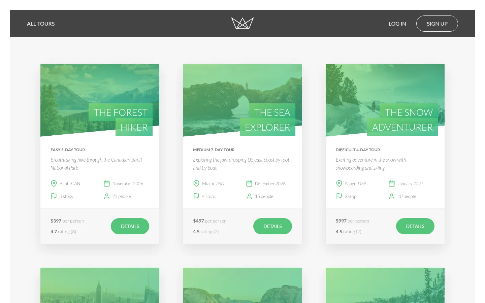
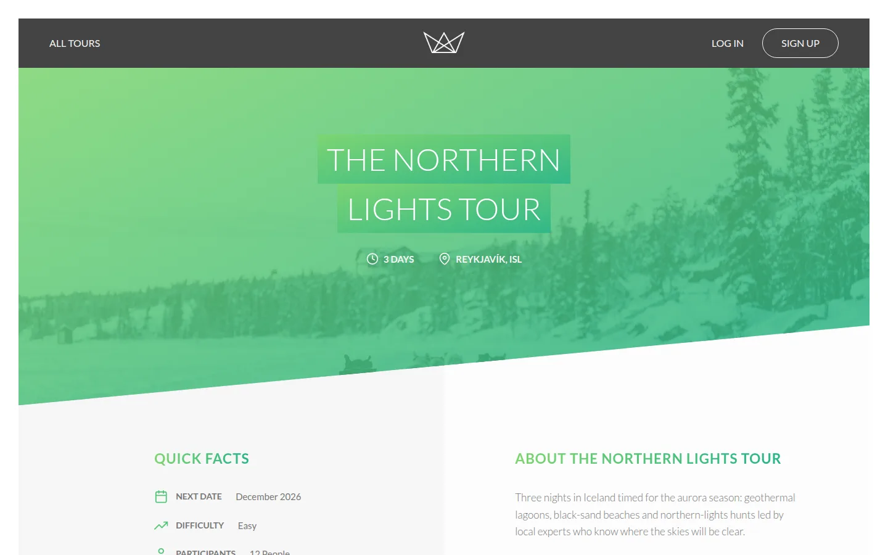
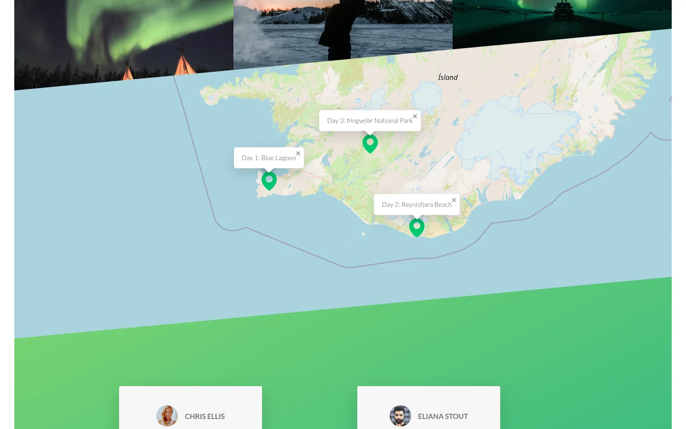
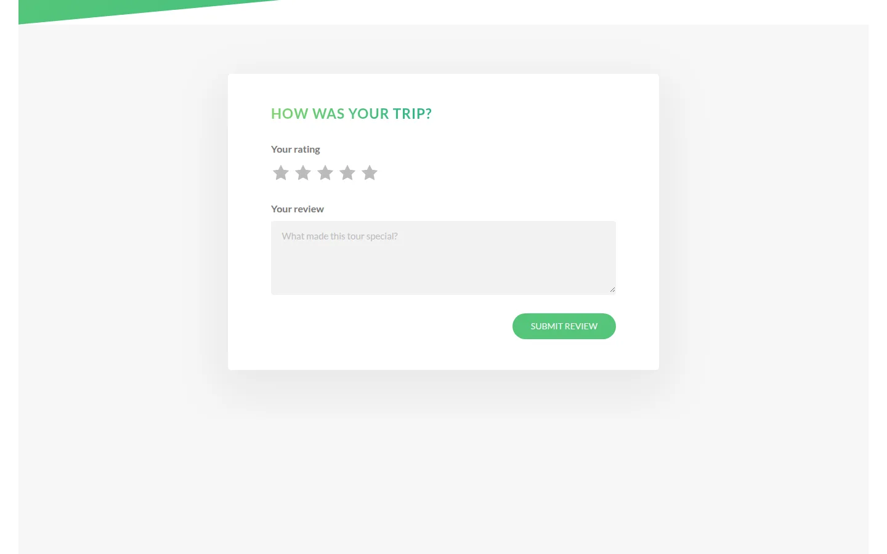
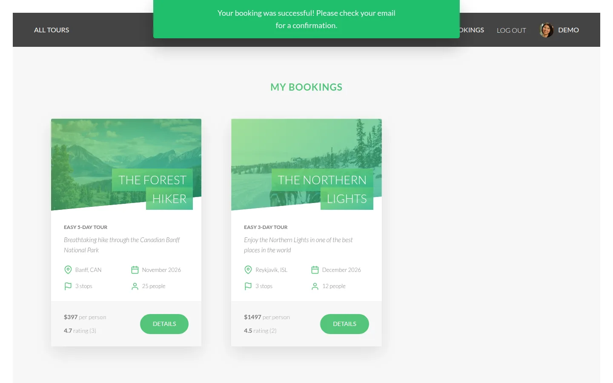
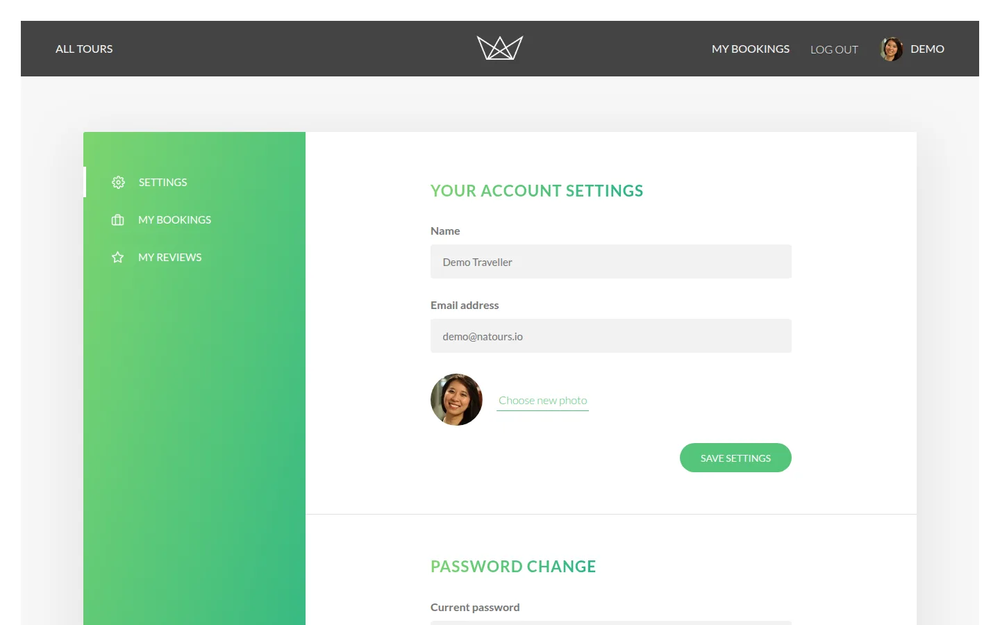
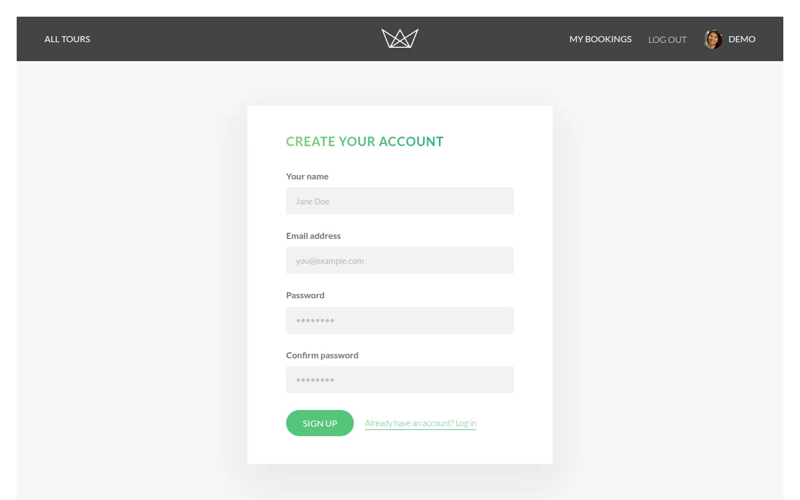

# Natours — Tour Booking App

A server-rendered tour booking application built with **Node.js, Express, MongoDB (Mongoose) and Pug**. It covers browsing tours, signing up, booking (with an optional Stripe Checkout), reviews, account management, and a filterable REST API behind JWT authentication.

> **Course project, extended.** Natours is the capstone of [Jonas Schmedtmann's *Node.js, Express, MongoDB & More* bootcamp](https://www.udemy.com/course/nodejs-express-mongodb-bootcamp/). The original design, page layouts and tour photos are his. I built the app through the course, then went back and fixed its bugs, closed security holes, modernised the stack and added the features listed under [What I added and fixed](#what-i-added-and-fixed).



| Tour page | Stops map (Leaflet + OpenStreetMap) |
| --- | --- |
|  |  |
| **Leave a review (booked tours only)** | **My bookings** |
|  |  |
| **Account settings** | **Sign up** |
|  |  |


---

## What I added and fixed

### Security
- **Closed a role-escalation hole:** signup accepted `role` from the request body, so anyone could register as `admin`. Signup now whitelists its fields.
- **Replaced the insecure booking shortcut:** the course's temporary `/?tour=&user=&price=` handler let anyone create a paid booking for any user at any price just by visiting a URL. It's gone. Bookings are now created either by a **signature-verified Stripe webhook** (idempotent per Checkout session) or, in demo mode, by an authenticated endpoint that reads the price from the database.
- **Content Security Policy:** helmet 8 with an explicit CSP that allowlists only the CDNs and tile server the app uses. Third-party scripts load with **Subresource Integrity** hashes.
- **Cookies:** the JWT cookie is now `sameSite=lax`, and `secure` whenever the request arrived over HTTPS (proxy-aware, via `trust proxy`).
- **Login redirects:** `?next=` only accepts same-site paths, which prevents open redirects.
- **Reviews:** only travellers who actually booked a tour can review it.
- **Alerts:** messages are rendered with `textContent`, not `innerHTML`.

### Bug fixes
| Bug | Effect | Fix |
| --- | --- | --- |
| `ratingsAvrage` typo in the review model | Tour ratings **never updated** when reviews changed | Correct field; also fixed the tour-stats aggregation, which had the same typo plus sum/average mix-ups |
| `default: Date.now()` on bookings | Every booking got the **server start time** | Pass the function reference |
| `.form-user-passowrd`, `#passowrd-current`… typos in the front-end | **Changing your password silently did nothing** | Rewritten account scripts |
| `{ ...err }` in the production error handler | `name` is lost, so cast, validation and JWT errors fell through as 500s | Normalise errors from the original object, in every environment |
| Error handler only handled `development` / `production` | Any other `NODE_ENV` meant **requests hung** with no response | Default branch |
| `-ratingAverage` sort in `/top-5-cheap` | The sort key didn't exist, so it was ignored | Fixed |
| Missing `return next(err)` in geo routes | Handlers ran on after sending an error | Fixed |
| Re-executing the query in review `findOneAnd*` middleware | Crashes on Mongoose 6+ | `this.clone()` |

### Features
- **Sign-up page**; the header link used to point to `#`.
- **Reviews from the UI:** a star-rating form appears on tours you've booked, plus a **My reviews** page.
- **Demo booking mode:** without Stripe keys, "Book tour" confirms instantly, so the whole flow runs locally with zero setup. With keys, it uses hosted Stripe Checkout and a webhook.
- **Leaflet + OpenStreetMap** instead of Mapbox, so the map needs **no API key**. Every stop's label opens once the map has fitted its bounds.
- **Login redirects back** to the page you came from, and logged-out visits to account pages go to login instead of an error screen.
- **Emails in development** are printed to the console when no SMTP server is configured, instead of crashing signup.
- **Responsive layout:** the course CSS is desktop-only; the tour grid, tour page, CTA, header and account area now adapt down to phone width.
- **Accessibility:** logout is a real `<button>`; form controls have autocomplete hints; there's a visible busy state on submit; the star picker works from the keyboard; and pinch-zoom is no longer disabled.
- **Empty states** for bookings and reviews, and a solid star icon (the original one was outline-only, so ratings never looked filled).

### Tooling
- **Seed script** (`npm run seed`) with original sample data: 9 tours, 20 people (admin, guides, travellers), bookings and reviews, with tour ratings computed from the reviews.
- **Docker Compose** for MongoDB, so one command gives you a local database.
- **Upgraded dependencies:** Mongoose 5 → 8, helmet 3 → 8, jsonwebtoken 8 → 9, Stripe 7 → 17, Pug 2 → 3, html-to-text 5 → 9, and **Parcel 1 → esbuild** (builds in about 25 ms).
- **Startup checks:** the server validates its required environment variables and shuts down gracefully on `SIGTERM`.
- **Cleanup:** removed unused packages, stray uploaded files and debug logging.

---

## Tech stack

| Layer | Tools |
| --- | --- |
| Server | Node.js, Express 4, MVC structure |
| Database | MongoDB, Mongoose 8 (geospatial queries, aggregation pipelines, virtual populate) |
| Views | Pug templates, vanilla JS bundled with esbuild, axios |
| Auth | JWT in httpOnly cookies, bcrypt, role-based authorisation, password reset tokens |
| Payments | Stripe Checkout and webhooks (optional) |
| Media | Multer uploads, Sharp resizing |
| Security | helmet (CSP), express-rate-limit, express-mongo-sanitize, xss-clean, hpp |
| Maps | Leaflet, OpenStreetMap tiles |
| Email | Nodemailer (SMTP in development, SendGrid in production) |

## Run it locally

Requirements: Node.js 18+ and Docker (or any MongoDB instance).

```bash
git clone https://github.com/montaser-hub/natours.git
cd natours
npm install
cp config.env.example config.env   # then set a JWT_SECRET
npm run db:up                      # MongoDB on localhost:27018 (Docker)
npm run seed                       # sample tours, users, bookings, reviews
npm run build:js
npm start                          # http://localhost:3000
```

**Demo accounts** (password `test1234`):

| Email | Role |
| --- | --- |
| `demo@natours.io` | traveller (has bookings, can leave a review) |
| `admin@natours.io` | admin |
| `miyah@natours.io` | lead guide |

### Optional: real payments with Stripe (test mode)

1. Add `STRIPE_SECRET_KEY` and `STRIPE_WEBHOOK_SECRET` to `config.env`.
2. Forward webhooks locally: `stripe listen --forward-to localhost:3000/webhook-checkout`.
3. Pay with the test card `4242 4242 4242 4242`.

## REST API

All routes live under `/api/v1`. Protected routes accept either the `jwt` cookie or an `Authorization: Bearer <token>` header.

| Resource | Endpoints |
| --- | --- |
| Auth | `POST /users/signup` · `POST /users/login` · `GET /users/logout` · `POST /users/forgotPassword` · `PATCH /users/resetPassword/:token` · `PATCH /users/updateMyPassword` |
| Me | `GET /users/me` · `PATCH /users/updateMe` (multipart, photo upload) · `DELETE /users/deleteMe` |
| Tours | `GET /tours` (filter, sort, fields, paginate: `?price[lt]=1000&sort=-ratingsAverage&fields=name,price&page=2`) · `GET /tours/:id` · `POST/PATCH/DELETE /tours/:id` (admin, lead guide) |
| Tour analytics | `GET /tours/top-5-cheap` · `GET /tours/tour-stats` · `GET /tours/monthly-plan/:year` (staff) |
| Geo | `GET /tours/tours-within/:distance/center/:lat,:lng/unit/:mi|km` · `GET /tours/distances/:lat,:lng/unit/:mi|km` |
| Reviews | `GET/POST /tours/:tourId/reviews` (you must have booked the tour to post) · `GET/PATCH/DELETE /reviews/:id` |
| Bookings | `POST /bookings/checkout/:tourId` · `GET/POST /bookings` and `GET/PATCH/DELETE /bookings/:id` (admin, lead guide) |
| Users (admin) | `GET /users` · `GET/PATCH/DELETE /users/:id` |

## Project structure

```
server.js            entry: env validation, DB connection, graceful shutdown
app.js               middleware stack (security, parsers, routes, error handler)
controllers/         route handlers, generic CRUD factory, error handling
models/              Tour, User, Review, Booking (Mongoose schemas and middleware)
routes/              API and view routers
views/               Pug templates (pages, partials, emails)
public/js/           front-end modules → bundled to public/js/bundle.js
dev-data/            seed script and sample data
utils/               APIFeatures (query builder), AppError, catchAsync, Email
```

## Credits and license

- Course, original design, page templates and tour/user photos: **[Jonas Schmedtmann](https://github.com/jonasschmedtmann)**, *Node.js, Express, MongoDB & More: The Complete Bootcamp*. All rights to that material remain with him.
- Implementation, fixes and the additions listed above: **Montaser Ismail**. My own additions are free to reuse.
- Map data © [OpenStreetMap](https://www.openstreetmap.org/copyright) contributors.
